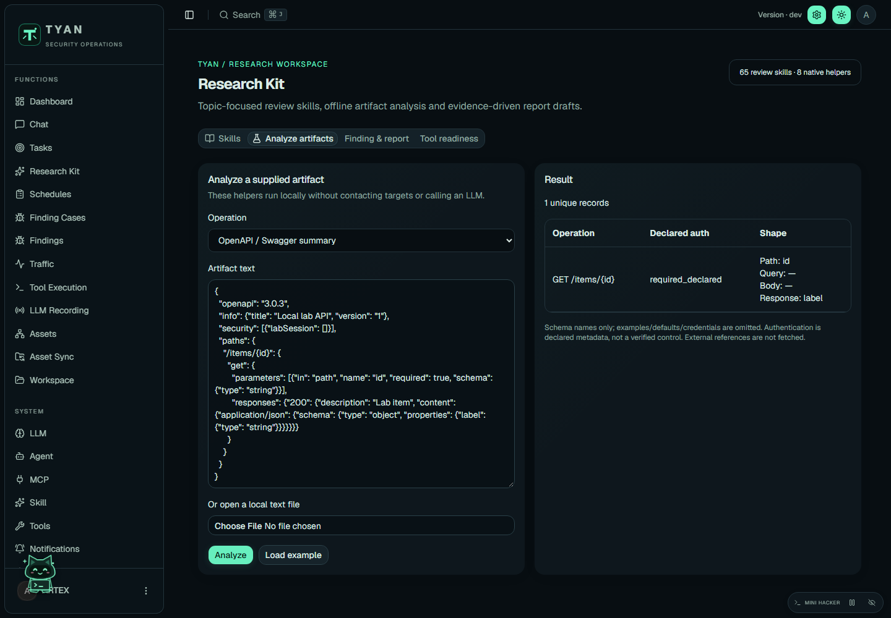
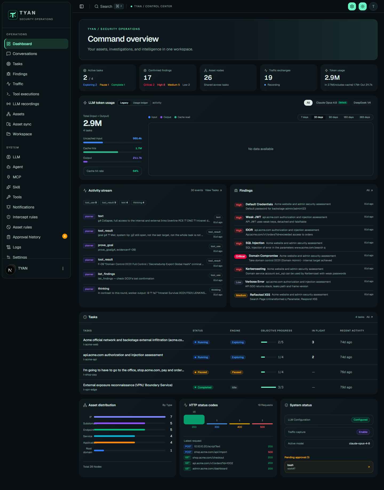
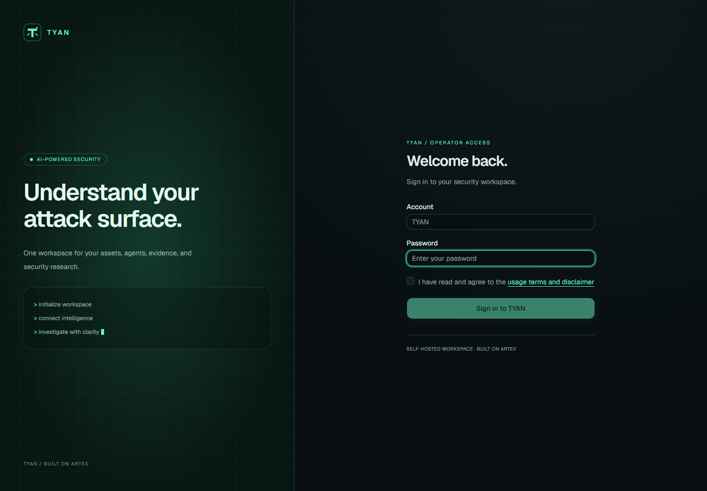
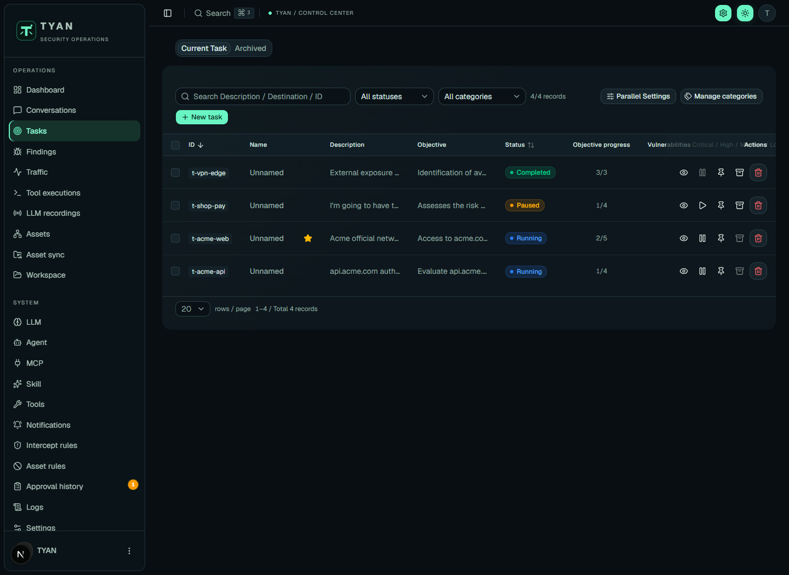
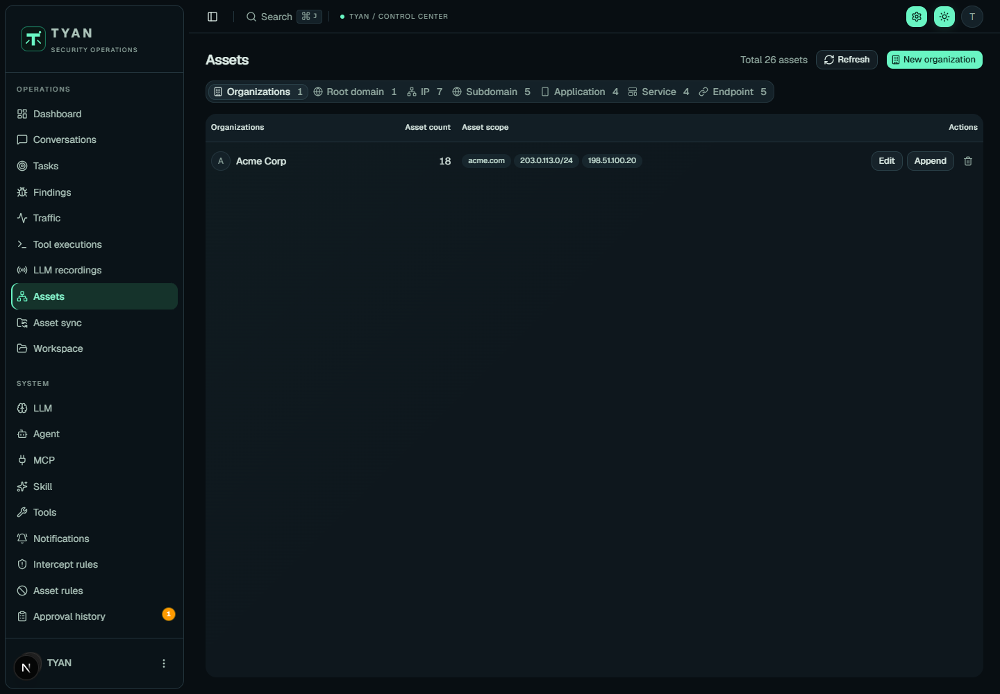
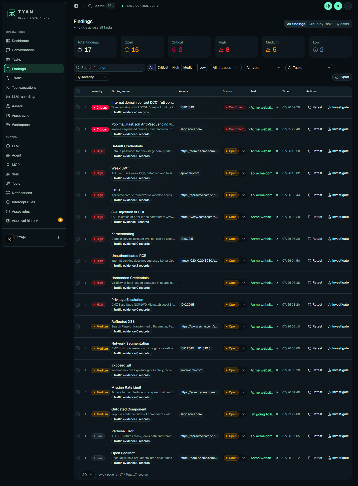
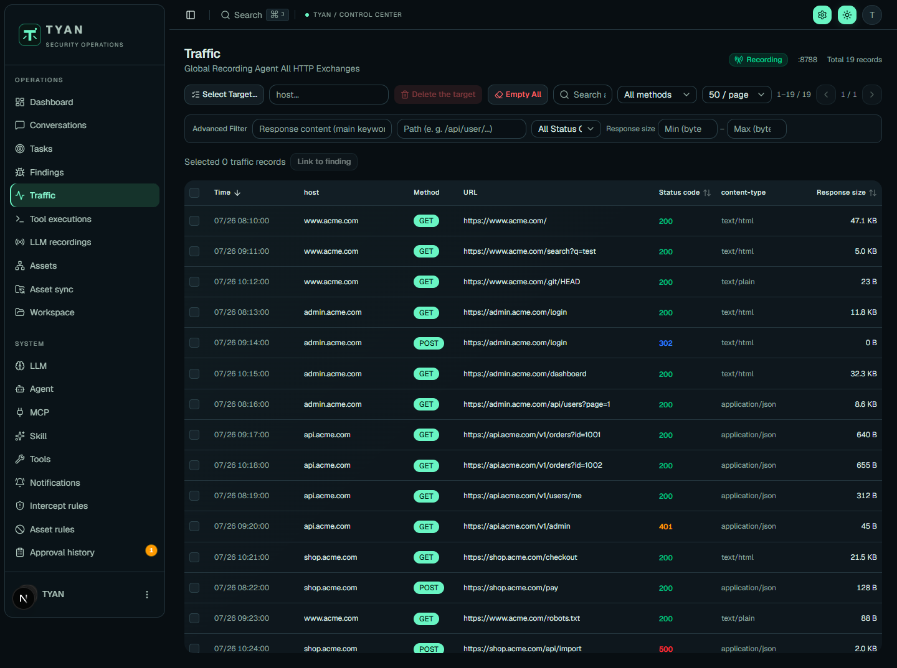

<div align="center">


# TYAN

AI-powered security operations console

[English](README.md) · [Tiếng Việt](README.vi.md) · [Original Chinese documentation](README.zh-CN.md)
</div>

TYAN is a customized edition of [ARTEX](https://github.com/mhtsec/ARTEX), with a modern terminal-inspired interface, a dark mint theme, and an English application interface. It combines a Go backend, a Next.js frontend, and PostgreSQL.

The original ARTEX authors and contributors retain their credits. See [LICENSE](LICENSE), [NOTICE](NOTICE), and the [original README](README.zh-CN.md).

> **For learning and security research in an isolated local lab only. Using TYAN to violate the law, access systems without permission, steal data, disrupt services, or harm others is strictly prohibited.** Installing or possessing this software does not grant permission to access any system. The upstream restrictions below also apply, including the prohibition on real-world testing against online or networked systems, even when owned or authorized.

## Additional lab workflows

Task schedules, finding cases, encrypted test-account credentials, operator handoff, an optional access gate, and a privacy-restricted local capture extension are now included. See [feature locations, setup and upgrade notes](FEATURES.md) before use. Existing usage restrictions still apply.


## Research Kit

**Functions → Research Kit** adds 65 topic-specific review skills and eight native agent helpers: skill discovery, executable readiness, OpenAPI/Swagger summaries, saved Nuclei/ffuf/Nmap normalization, evidence redaction, CVSS 4.0 scoring, finding readiness and report drafts. The workbench includes Markdown preview and basic DOCX export.

Adapted from `claude-redteam`, with pinned provenance and MIT attribution. These are review adaptations, not copies of upstream execution engines or model-offload hooks. See the [user guide](docs/RESEARCH-KIT.md) and [complete integration mapping](integrations/claude-redteam/README.md) for setup and limits. Rebuild and restart to use the new code.



## Interface preview



The dashboard brings task activity, findings, asset distribution, traffic statistics, and token usage into one view.

| Operator sign-in | Task management |
| --- | --- |
|  |  |
| Password-based access and the usage notice. | Task status, objectives, filters, and execution controls. |

### Asset inventory

Organize organization scopes and inspect domains, IPs, applications, services, and endpoints.



### Findings and evidence

Review severity, resolution status, affected assets, and linked traffic evidence.



### HTTP traffic

Browse captured exchanges by host, method, URL, response status, and size.



Screenshots show the TYAN interface; dashboard and task records are bundled sample data. They do not demonstrate a live backend deployment or verified assessment results. Other screenshots without the `tyan-` prefix show the upstream interface.

## Features

| Area | Capabilities |
| --- | --- |
| **Dashboard** | View task states, recent activity, finding severity, asset distribution, HTTP status codes, and LLM token usage. |
| **Tasks and templates** | Define objectives and scope, create reusable templates and categories, pause/resume tasks, and manage archived task data. |
| **Agent workspaces** | Inspect planner and worker sessions, tool calls, exploration graphs, asset coverage, and task broadcasts. |
| **Conversations** | Discuss records with agents, reference findings or assets in messages, and inspect conversation history. |
| **Asset inventory** | Organize domains, IPs, subdomains, applications, services, and endpoints; maintain organization scopes and synchronize external asset sources. |
| **Findings and reports** | Review severity and resolution status, associate findings with assets, start retest sessions, and export reports. AI-generated conclusions require human verification. |
| **Traffic and evidence** | Inspect captured HTTP requests/responses, filter exchanges, and link evidence to findings with roles, notes, and ordering. Automatic evidence linking is optional and can increase token usage. |
| **LLM configuration** | Configure provider endpoints, models, API keys, proxies, rate limits, fallback configurations, and retry/backoff behavior. |
| **Agents, skills, and tools** | Configure agent prompts and visibility, manage skills and custom tools, and connect MCP servers. Available capabilities depend on installed tools and runtime configuration. |
| **Approval controls** | Configure allow/block rules and model-assisted or manual review; inspect approval context and execution results. These controls do not guarantee legal compliance or eliminate operational risk. |
| **Notifications** | Configure channels such as DingTalk, Feishu, WeCom, webhooks, and email, with filters and delivery history. External channels require separate configuration. |
| **Operations and interface** | Inspect backend logs, manage workspace files, and use responsive layouts with light/dark themes and TYAN branding. |

The application interface uses English; repository guides are available in English and Vietnamese. User content, model responses, and existing stored data retain their original language.

## Intended workflow

1. Read the usage restrictions and prepare an isolated local lab containing only permitted test data and targets.
2. Configure the database, LLM connection, and required local tools. Review which information your selected external providers receive.
3. Define the task scope, objectives, constraints, and agent/tool permissions before execution.
4. Monitor sessions and approval requests; verify findings against the collected evidence instead of treating model output as fact.
5. Review exported reports, protect sensitive artifacts, and retain or delete lab data according to your obligations.

## Run from source with Docker

Install Docker with Compose support. On Windows, use Docker Desktop with Linux containers. Run commands from the repository root.

1. Copy `.env.example` to `.env` and set a strong `POSTGRES_PASSWORD`:

   ```powershell
   Copy-Item .env.example .env
   ```

   Linux/macOS: `cp .env.example .env`.

2. Build this checkout and start the services:

   ```sh
   docker compose up -d --build
   ```

3. Open [http://localhost:8787](http://localhost:8787). On first launch, set an administrator password on `/setup`, then sign in.
4. Configure the LLM provider, model, base URL, and API key in the application. You can also set `ANTHROPIC_API_KEY` or `OPENAI_API_KEY` in `.env` before starting.

Compose builds a local TYAN image. An upstream prebuilt ARTEX image does not contain these changes.

```sh
docker compose logs -f artex
docker compose down
```

Keep the PostgreSQL volume and `data/` directory to retain your instance. Back up both PostgreSQL and `data/`, including evidence, before upgrades.

## Frontend development and preview

Requirements: Node.js 20.9+ and npm. The lockfile pins frontend dependencies.

```sh
cd web
npm ci
npm run dev
```

The UI runs at [http://localhost:3000](http://localhost:3000) and forwards `/api` to `http://localhost:8787`. Set `AUTOPENTEST_API` to use another backend URL.

Preview with bundled sample data, without a backend or database:

```powershell
cd web
$env:NEXT_PUBLIC_MOCK="1"
npm run dev
```

Linux/macOS: `NEXT_PUBLIC_MOCK=1 npm run dev` from `web/`. Mock mode only previews the interface. Unset the variable and restart before connecting to a real backend.

Validate frontend changes:

```sh
cd web
npx tsc --noEmit
npm run build
```

Build the static frontend on Windows:

```powershell
cd web
$env:NEXT_EXPORT="1"
npm run build
```

Linux/macOS: `NEXT_EXPORT=1 npm run build`. Output goes to `web/out/`; Docker embeds it automatically.

## Backend and compatibility

### Native Windows startup

After building `tyan.exe` with the embedded production frontend and configuring PostgreSQL in `config.json`, use:

```powershell
powershell -NoProfile -ExecutionPolicy Bypass -File .\start-tyan.ps1
```

Alternatively, double-click `start-tyan.bat`. Open [http://127.0.0.1:8787](http://127.0.0.1:8787), then choose your administrator password on first use. Stop the local instance with `powershell -NoProfile -ExecutionPolicy Bypass -File .\stop-tyan.ps1`.

The launcher binds TYAN to the local machine only. If a portable PostgreSQL cluster exists in `.tyan-runtime/postgres-data`, it starts that cluster too. Logs are in `data/`; database credentials are stored in the ignored `config.json`. Keep `.tyan-runtime/`, `data/`, and `config.json` private and back up the database before replacing or removing the runtime. These local runtime files are not included in the repository.

### Development and technical identifiers

For native development, install the Go version declared in [go.mod](go.mod) and PostgreSQL. Copy `config.example.json` to `config.json`, configure the database, and run `go run ./cmd/artex` from the root. The backend defaults to port `8787`. Native backend development does not automatically embed a new frontend; use the Next.js dev server or Docker build above.

TYAN keeps the upstream Go module path, `cmd/artex`, Compose service name `artex`, database defaults, and `ARTEX_*` environment variables for compatibility. The fixed backend account identifier remains `ARTEX`; the sign-in form supplies it automatically. These identifiers are separate from TYAN's display branding.

Update this source checkout and rebuild to preserve TYAN. An upstream binary self-update can replace the customized executable and embedded interface with ARTEX.

## Project layout

| Path | Purpose |
| --- | --- |
| `web/` | Next.js UI and shared components |
| `server/`, `cmd/artex/` | HTTP API, authentication, backend entry point |
| `agent/`, `llmpool/`, `skills/` | Agent runtime, model integration, bundled skills |
| `db/`, `evidence/`, `traffic/` | Persistence, evidence snapshots, traffic capture |
| `config.example.json`, `.env.example` | Configuration examples |

## Responsible use and prohibited conduct

**Do not use TYAN for unlawful activity or to infringe the rights, privacy, or security of any person or organization.** In particular, prohibited misuse includes:

- Unauthorized access, bypassing access controls, account takeover, or attempts to obtain credentials without permission.
- Stealing, disclosing, modifying, or destroying personal, confidential, or proprietary data.
- Phishing, fraud, extortion, malware distribution, or deploying persistence for malicious purposes.
- Denial of service, service disruption, sabotage, or other destructive activity.
- Using agents, tools, proxies, or external services to conceal or facilitate unlawful actions.
- Removing or falsifying copyright, license, attribution, or safety notices.

**The upstream terms are stricter than a general authorization requirement:** they limit use to learning, source research, and technical verification in a local isolated environment. They prohibit actual scanning, probing, exploitation, penetration testing, or attacks against websites, online services, networked systems, or production environments, including assets you own or have permission to test. Written authorization alone does not override those stated restrictions.

You are responsible for reviewing the applicable terms and laws, controlling the scope and permissions of each run, protecting credentials and evidence, and checking agent actions and outputs. A tool feature, an approval decision, an AI response, or this README is **not legal authorization**. Stop if the intended use falls outside the permitted scope. The authors and maintainers do not endorse or authorize misuse.

## License and disclaimer

The root project uses **GNU AGPL-3.0**; retain all applicable notices, including component-specific notices. See [LICENSE](LICENSE). The original README also states additional usage terms: study, source-code research, and technical verification in a local isolated environment only; no scanning, probing, exploitation, actual penetration testing, or attacks against websites, online services, networked systems, or production environments, even when owned or authorized. The original terms and disclaimer are retained in [README.zh-CN.md](README.zh-CN.md) and the application sign-in notice.

The software is provided **AS IS**, without warranties. AI output may be inaccurate, incomplete, or unsafe to execute; human review is required. Users are responsible for their actions and consequences. No disclaimer grants an exemption from applicable law or removes obligations that cannot legally be excluded. Refer to the original notices for the full terms; this English overview does not replace them.
